# CYDex

**A desk Dex for the ~$15 "Cheap Yellow Display".** Browse all 1025 species, track the ones you've caught in your own save files, and leave it on your desk as a living showcase that also pings you when something needs your attention.

<p align="center">
  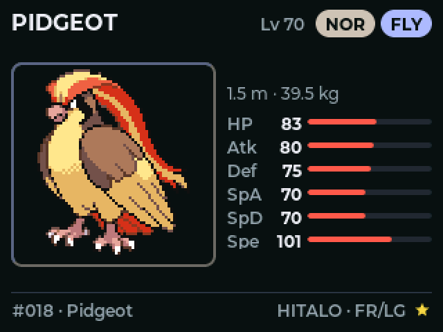
</p>

<p align="center">
  <a href="#screens">Screens</a> ·
  <a href="#notifications-from-anything">Notifications</a> ·
  <a href="#desktop-companion">Desktop app</a> ·
  <a href="#under-the-hood">Under the hood</a> ·
  <a href="#getting-started">Getting started</a>
</p>

---

## What it does

- **📖 The whole national catalog.** 1025 species across nine generations, in a list or a sprite grid. Filter by caught or missing, by up to two types, or search by name or number. Jump straight to a generation.
- **💾 Your progress, from your real saves.** Drop your Gen 3 saves (FireRed/LeafGreen, Ruby/Sapphire/Emerald) on the SD card and CYDex marks what you've seen and caught. Species you haven't met stay a mystery: `???`. Open a save to see your party, your boxes and every Hall of Fame team, and the entry of any species tells you where you keep it.
- **🖼️ Showcase mode.** A trading card style display that rotates through your collection (or just your current team) every 30 seconds to 15 minutes. It shuffles without repeats, dims itself after sunset, and shifts a pixel or two each time so the screen doesn't burn in.
- **🔔 Notifications from anything on your network.** A tiny HTTP API lets any script, CI job or smart home hub put a message on the screen. Claude Code integration comes built in.
- **🖥️ A desktop companion.** A tray app that sleeps and wakes the display along with your computer and uploads saves over Wi-Fi.

Everything runs on the board itself: no server, no cloud, no account.

## Screens

Real screenshots, captured from the device over USB.

| | | |
|:-:|:-:|:-:|
| 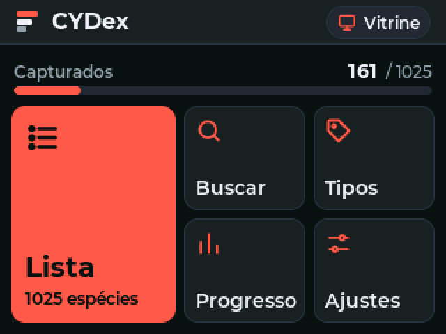<br><sub>Home</sub> | 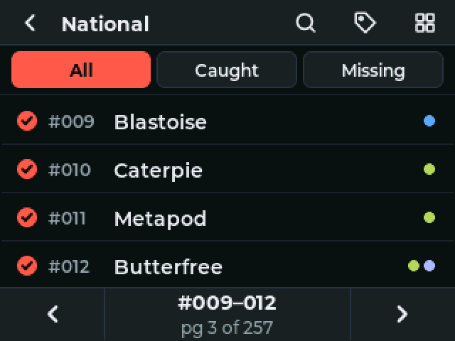<br><sub>List</sub> | 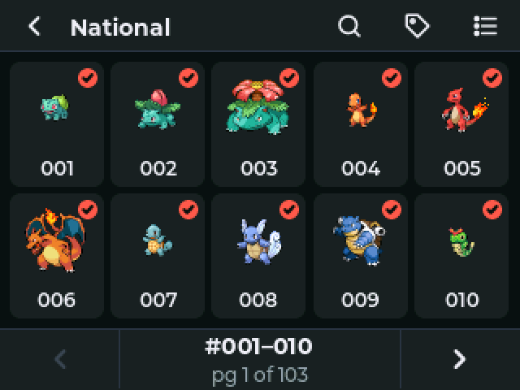<br><sub>Grid</sub> |
| 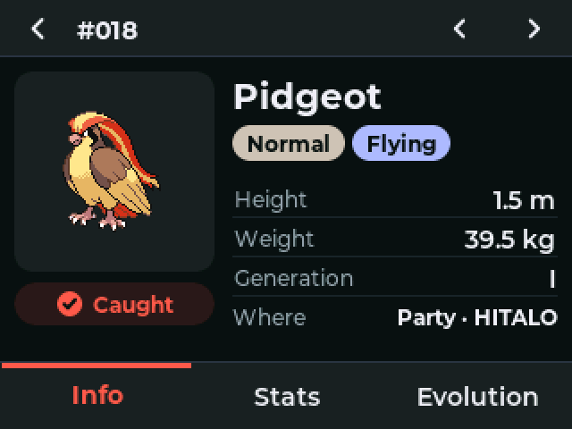<br><sub>Entry</sub> | 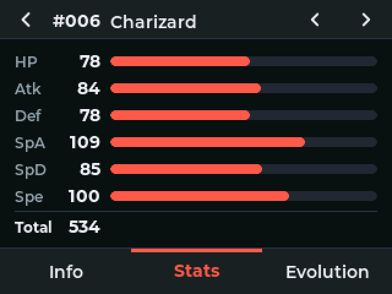<br><sub>Base stats</sub> | 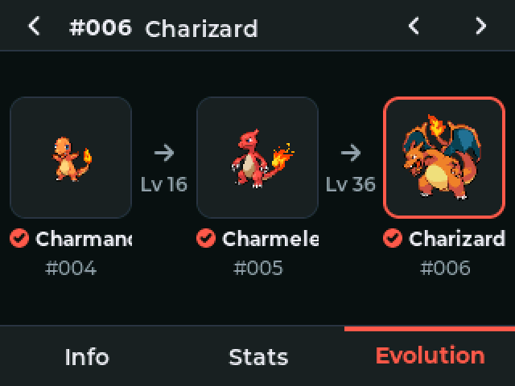<br><sub>Evolution line</sub> |
| 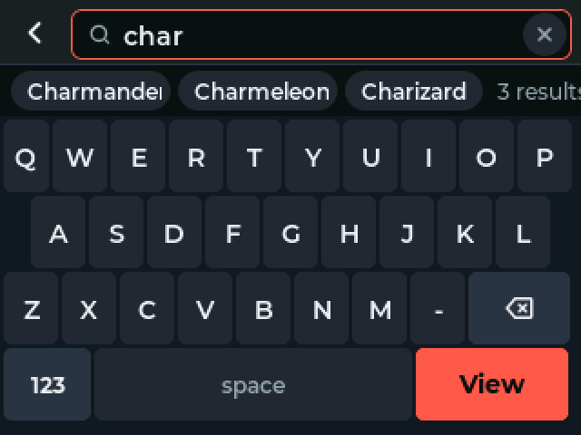<br><sub>Search</sub> | 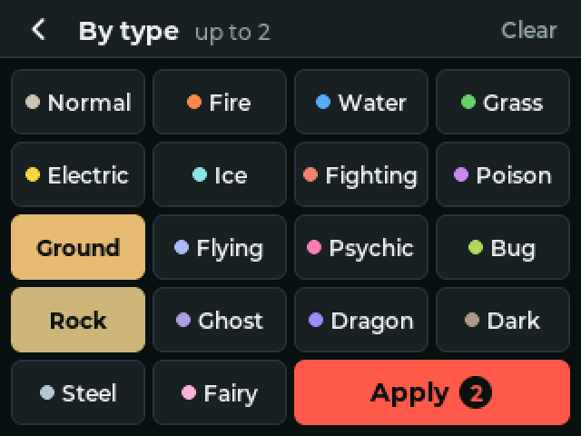<br><sub>Type filter</sub> | 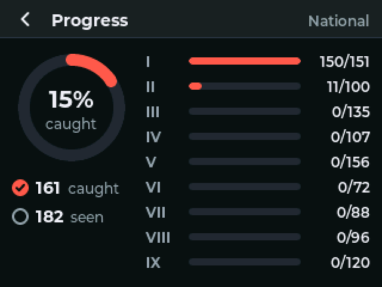<br><sub>Progress by generation</sub> |

### Your saves

Every save on the card gets its own page: trainer, play time, badges, money and that save's dex, plus the current party and all 14 boxes. Tap any creature for its real stats, nature, held item and moves. The Hall of Fame gathers every champion team from every save.

| | | |
|:-:|:-:|:-:|
| 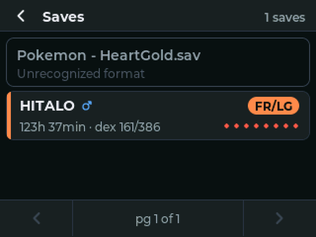<br><sub>Saves</sub> | 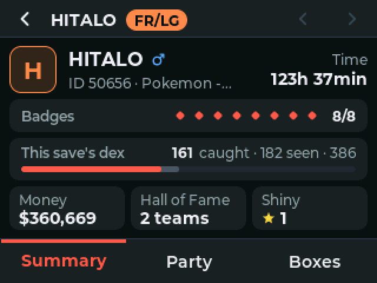<br><sub>Save summary</sub> | 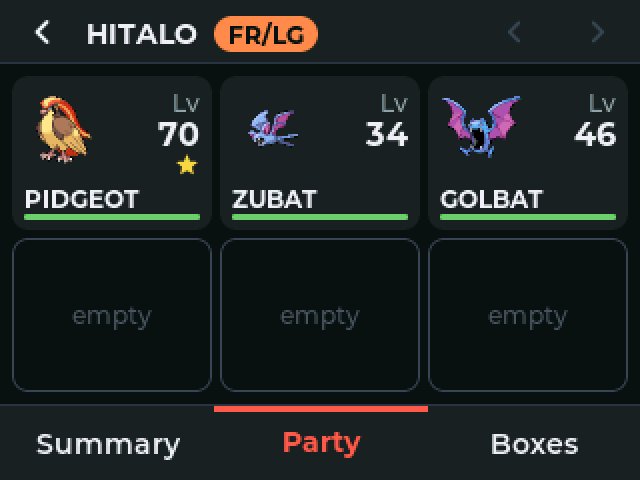<br><sub>Party</sub> |
| 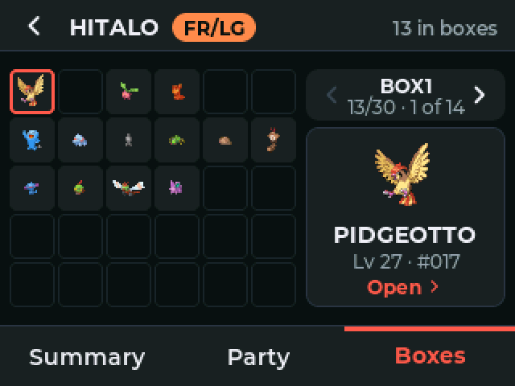<br><sub>Boxes</sub> | 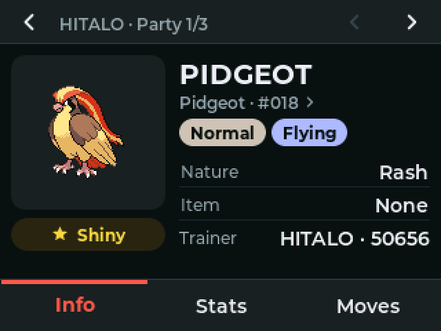<br><sub>Party member</sub> | 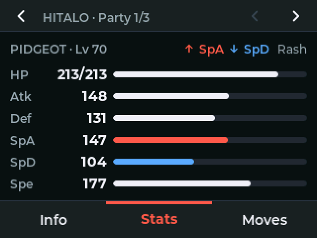<br><sub>Real stats, nature up/down</sub> |
| 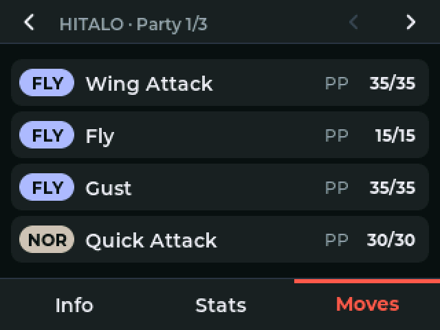<br><sub>Moves</sub> | 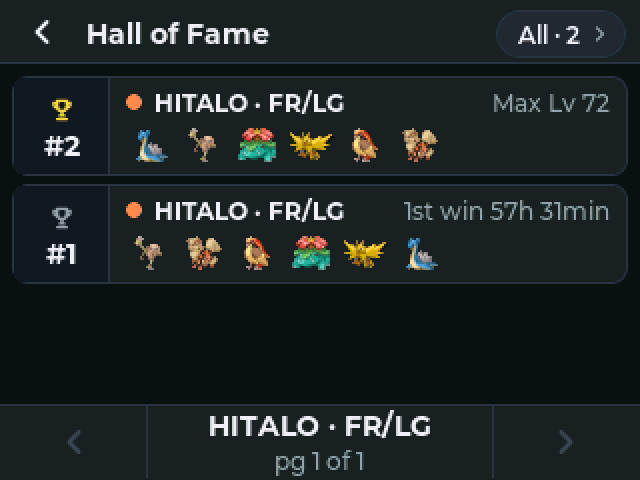<br><sub>Hall of Fame</sub> | 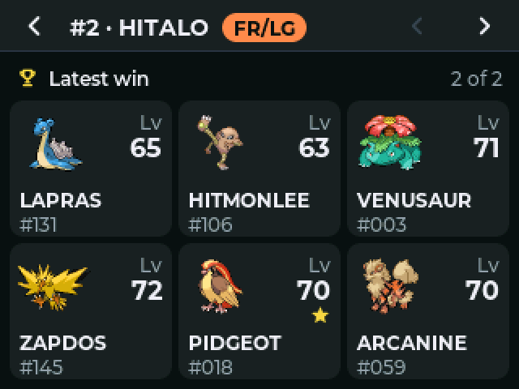<br><sub>Champion team</sub> |

The interface is deliberately calm: no scrolling, no animations, one redraw per tap, and a dark theme that suits the CYD's viewing angles. It ships in English and Portuguese.

## Notifications from anything

Turn on Wi-Fi and the CYD answers at `http://cydex.local`. One `curl` is all it takes:

```sh
curl -4 http://cydex.local/notices \
  -H "Authorization: Bearer $CYDEX_KEY" \
  -d '{"title":"Build passed","subtitle":"GitHub Actions","type":"success"}'
```

<p align="center">
  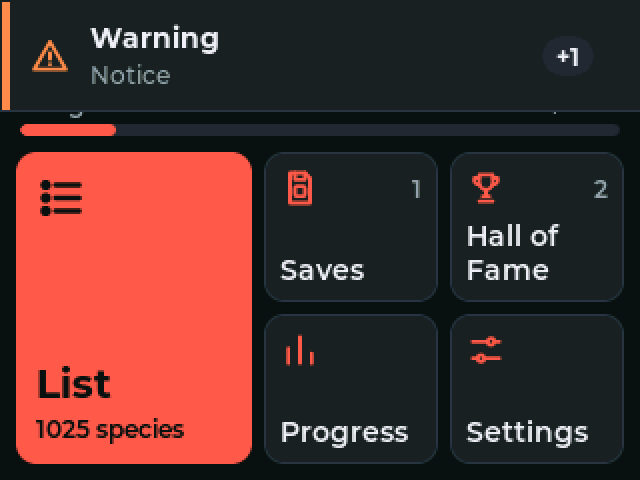
  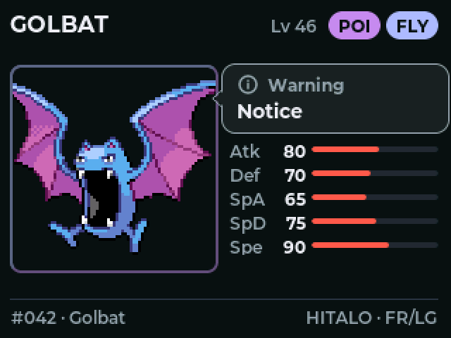
</p>

Notifications come with colors, icons, priorities and timeouts. Reusing an `id` updates the message in place, so one build or one chat keeps a single entry. Outside the showcase they appear as a banner; on the showcase they stack as speech bubbles next to the sprite.

**Claude Code** hooks are included: the display tells you when Claude needs a permission, is waiting for you or has finished, and clears itself once you're back. Your prompts never leave your computer.

## Desktop companion

A small tray app for **macOS, Windows and Linux** that:

- turns the display off when your computer sleeps and back on when it wakes;
- uploads your save files over Wi-Fi (drag and drop);
- shows your progress per generation and any open notifications;
- sends your city so the display knows when the sun sets;
- finds the CYD on your network by itself.

Grab it from the [releases](https://github.com/hitaloose/cydex/releases).

## Under the hood

| | |
|---|---|
| **Board** | ESP32-2432S028 ("Cheap Yellow Display"): a 2.8" 320×240 touchscreen, microSD slot and Wi-Fi, no PSRAM |
| **Firmware** | C++ on PlatformIO + Arduino, UI in LVGL 8 with custom fonts and icons |
| **Data** | Species, sprites, moves and items packed into a few files on a FAT32 SD card, generated by a Python script from [PokeAPI](https://pokeapi.co/) |
| **Desktop app** | Tauri 2 (Rust + TypeScript) |
| **Tests** | Board-independent logic (save parser, search, paging, notifications, translations) runs as native unit tests on your computer |

Fitting a full catalog, sprites and Wi-Fi into a microcontroller with no PSRAM took some care: sprites stream from the SD card, memory is reserved up front, and every screen has a budget. The notes live in [`CLAUDE.md`](CLAUDE.md).

## Getting started

You'll need an **ESP32-2432S028** (the version without the "R"), a **microSD card** and, optionally, a small speaker for tap sounds.

```sh
python3 tools/build_sd.py --out build/sd   # 1. build the SD card contents (downloads from PokeAPI)
pio run -e cyd -t upload                   # 2. flash the firmware
```

3. Copy `build/sd/` to the card, put your saves in `/saves`, and power it up.

The [full guide](docs/guia.md) (in Portuguese) covers the hardware details, the complete notification API, the Claude Code hooks, the desktop app and development.

## Roadmap

- Saves from other generations
- Save backups through the desktop app
- More notification integrations
- Trading between devices over ESP-NOW
- Shiny sprites for shiny creatures in your saves
- A redesigned desktop app that can change the display's settings
- Simpler brightness: one level for day, one for night

## License

The code is [MIT](LICENSE). Montserrat is under the SIL Open Font License; LVGL and TFT_eSPI are under their own licenses.

> CYDex is a fan project, unaffiliated with Nintendo, Game Freak or The Pokémon Company. This repository contains no game data or sprites: the build script downloads them from PokeAPI on your own machine. Names, images and trademarks belong to their respective owners.
